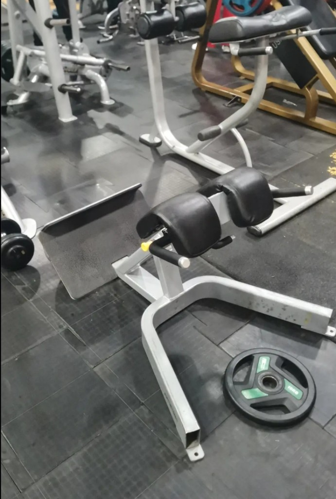

# Гиперэкстензия

**Группа:** корпус (поясница, ягодицы)  
**Схема:** A и B (четверг)  
**Картинка:**

## Как делать
1. Ноги на платформе, бёдра на подушках — край подушки примерно у сгиба бедра, не на животе.
2. Корпус вниз с прямой спиной, без рывка; вниз до комфортной растяжки, не «ломай» поясницу.
3. Вверх до прямой линии корпуса с ногами — не задирай голову и не уходи в сильный прогиб.
4. Руки на груди или блин к груди, если свой вес уже лёгкий.

## Ошибки
- Полный прогиб вверху «мостиком»
- Круглая спина вниз под большим весом
- Слишком высоко поднятые подушки — давление на живот

## Мой макс / рабочий
| Дата | Снаряд | Рабочий на 12–15 | Заметка |
|------|--------|------------------|---------|
| — | блин / свой вес | — | старт |
