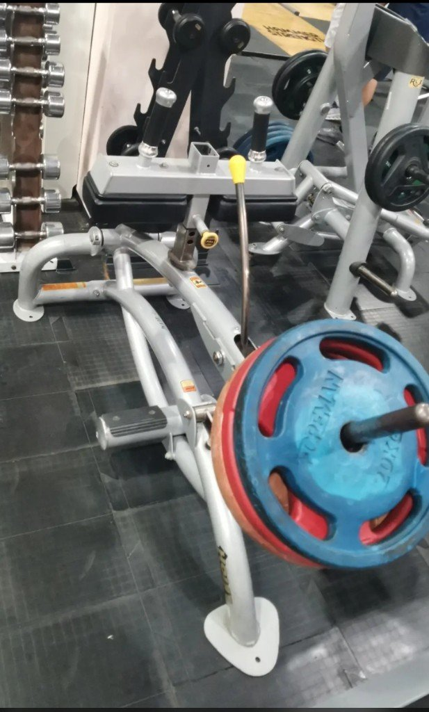

# Подъём на носки стоя

**Группа:** икры  
**Схема:** B  
**Картинка:**

## Как делать
1. Носки на платформы, пятки свисают ниже края. Валики на плечи, корпус прямой.
2. Колени чуть мягкие, не закрывай их в замок и не сгибай в присед.
3. Сними жёлтый фиксатор и поднимись на носки до конца, пауза 1 сек вверху.
4. Опусти пятки вниз на полную амплитуду, без отскока. Вес — блины на штыре.

## Ошибки
- Только пол-амплитуды
- Отскок из нижней точки
- Сгибание коленей и читинг корпусом

## Мой макс / рабочий
| Дата | Рабочий на 12–15 | Заметка |
|------|------------------|---------|
| — | 40 | оценка, блины на штыре |
